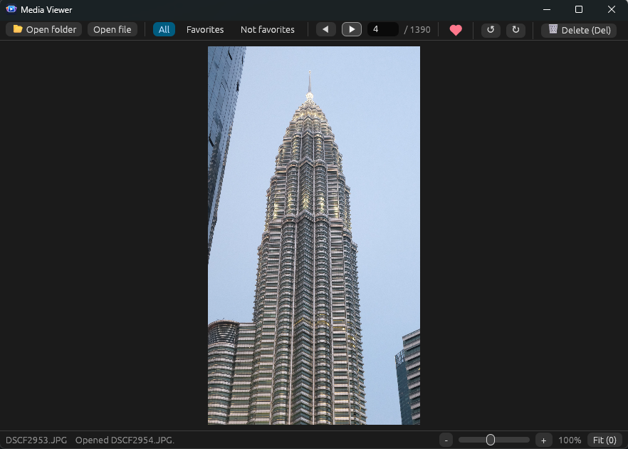
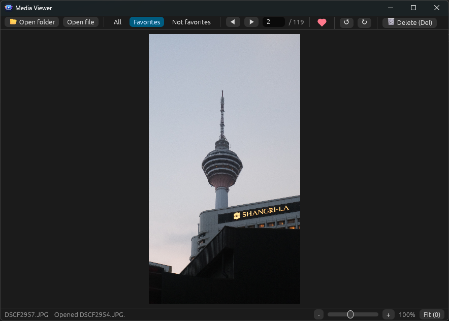
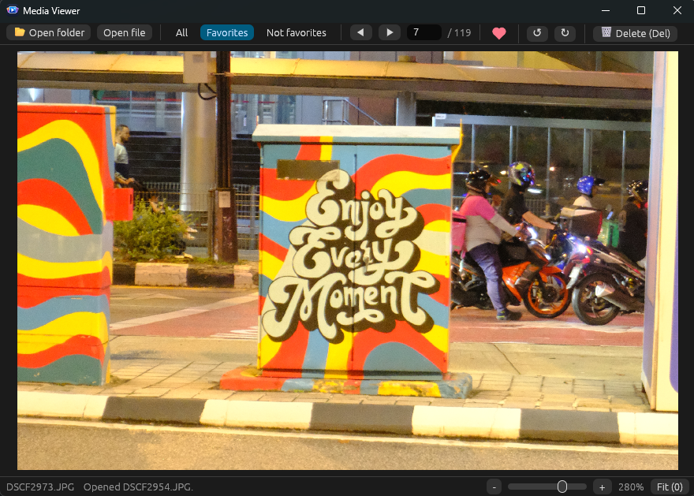
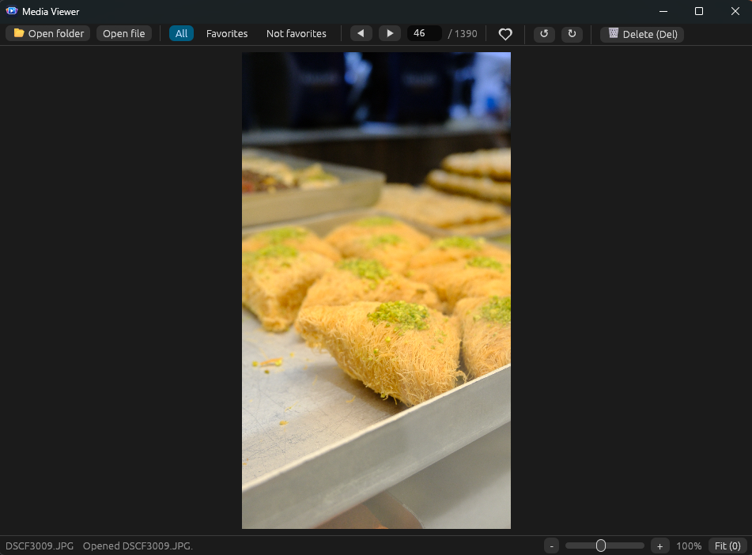
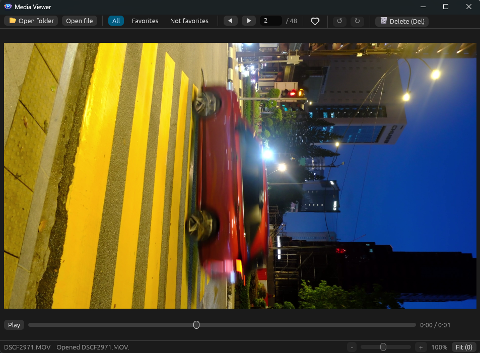

<h1 align="center">
  
</h1>

<p align="center">
  <a href="https://github.com/shua-shua-jo/media-viewer/actions/workflows/ci.yml"></a>
  <a href="https://github.com/shua-shua-jo/media-viewer/releases/latest"></a>
  <a href="LICENSE"></a>
</p>

A fast, lightweight desktop app for browsing the photos and videos in a folder. Built in Rust with [egui](https://github.com/emilk/egui) / eframe.

Open a folder (or a single file), flip through your media, and mark favorites with a heart. Favorites are automatically copied into a `Favorites` subfolder, so your best shots are always collected in one place.

<p align="center">
  
</p>

## Contents

- [Contents](#contents)
- [Features](#features)
- [Screenshots](#screenshots)
- [Install](#install)
  - [Verify your download](#verify-your-download)
- [Usage](#usage)
- [Keyboard shortcuts](#keyboard-shortcuts)
- [Build from source](#build-from-source)
  - [Requirements](#requirements)
  - [Run](#run)
  - [Build a standalone app](#build-a-standalone-app)
  - [Optional: `.exe` file icon on Windows](#optional-exe-file-icon-on-windows)
- [Optional: embedded video playback](#optional-embedded-video-playback)
- [Project structure](#project-structure)
- [Configuration](#configuration)
- [Known limitations](#known-limitations)
- [Security and changelog](#security-and-changelog)
- [Dependencies](#dependencies)
- [License](#license)

## Features

**Browsing**
- Opens any folder and shows the photos and videos directly inside it (sorted by name by default).
- Sort by name, date modified, or size, in either direction, from the toolbar. Name order is "natural": `img2.jpg` comes before `img10.jpg`.
- Photos: JPG, JPEG, PNG, GIF, WebP, BMP.
- Videos: MP4, MOV, MKV, AVI, WebM, M4V. Videos open in your default player; builds made with the optional `video` feature play them inside the app ([details below](#optional-embedded-video-playback)).
- Previous / next buttons, arrow keys, and a number box to jump straight to any item.

**Opening files**
- Open a folder, or a single photo or video: its folder opens with that file selected.
- From the command line, the **Open file** button, or by dragging a file or folder onto the window.
- Photos taken in portrait mode display upright (JPEG and WebP orientation data is applied).

**Favorites**
- Click the heart (or press `F`) to favorite. Hollow heart = not favorited, filled light red = favorited.
- A favorite is copied into a `Favorites` subfolder inside the folder you're browsing. Your original is never touched.
- Click the heart again to remove the favorite (the copy is deleted).
- Filter the view with **All**, **Favorites**, or **Not favorites**.

**Zoom**
- Mouse wheel (or trackpad pinch) zooms toward the cursor.
- Zoom slider and `+` / `-` buttons in the bottom bar.
- Drag to pan while zoomed in. Double-click the image, press `0`, or click **Fit** to reset.

**Rotate**
- Rotates the *view only*. The file on disk is never changed.
- Each photo remembers its rotation while the app is open.

**Delete**
- Sends the file to the Recycle Bin / Trash, so it can be recovered.
- A copy in `Favorites`, if there is one, is left alone.

**Performance**
- Images are decoded on background threads, and the next few photos are preloaded, so moving between photos feels instant.
- Only a small window of images is kept in memory at a time.

## Screenshots

<table>
  <tr>
    <td align="center">
      <br>
      <em>Favorite photos with the heart, then filter by them</em>
    </td>
    <td align="center">
      <br>
      <em>Zoom with the wheel or slider, drag to pan</em>
    </td>
  </tr>
  <tr>
    <td align="center">
      <br>
      <em>Open a file, or drag it onto the window</em>
    </td>
    <td align="center">
      <br>
      <em>Embedded video playback (optional build)</em>
    </td>
  </tr>
</table>

## Install

1. Download the file for your system from the [Releases](../../releases) page:

   | System | File |
   |---|---|
   | Windows | `media-viewer-<version>-windows-x86_64.zip` |
   | Linux | `media-viewer-<version>-linux-x86_64.tar.gz` |
   | macOS (Apple Silicon) | `media-viewer-<version>-macos-arm64.tar.gz` |
   | macOS (Intel) | `media-viewer-<version>-macos-x86_64.tar.gz` |

2. Unzip it and run `media-viewer` (`media-viewer.exe` on Windows).
3. *(Optional)* [Verify the download](#verify-your-download).

**First-run warnings.** These downloads are not code-signed yet, so your system may warn you the first time you run the app.
- **Windows:** SmartScreen may say "Windows protected your PC". Click **More info**, then **Run anyway**.
- **macOS:** if the app is blocked, run `xattr -d com.apple.quarantine ./media-viewer` once, then open it.
- **Linux:** requires GTK 3, which most desktops include. If the file won't start, run `chmod +x media-viewer`.

### Verify your download

Each release includes `SHA256SUMS.txt`. Compare your file's checksum with the matching line:

```powershell
# Windows (PowerShell)
Get-FileHash .\media-viewer-<version>-windows-x86_64.zip -Algorithm SHA256
```
```bash
# Linux / macOS
sha256sum -c SHA256SUMS.txt --ignore-missing
```

Release files also carry a build attestation proving they were built by this repository's workflow. With the [GitHub CLI](https://cli.github.com/):

```bash
gh attestation verify <downloaded-file> --repo shua-shua-jo/media-viewer
```

## Usage

Start the app and click **Open folder** or **Open file**, drag a file or folder onto the window, or pass a path on the command line:

```text
media-viewer photo.jpg           # opens the photo's folder, starting at photo.jpg
media-viewer "D:\Photos"         # opens a folder
```

**Open with from Windows Explorer.** Right-click a photo, choose **Open with**, then **Choose another app**, and pick `media-viewer.exe`. Tick **Always use this app** to make it the default for that file type.

## Keyboard shortcuts

| Key | Action |
|---|---|
| `←` / `→` | Previous / next |
| `F` | Favorite / unfavorite |
| `R` / `L` | Rotate view right / left |
| `Delete` | Move to Recycle Bin / Trash |
| `+` / `-` | Zoom in / out |
| `0` | Reset zoom to fit |
| `Space` | Play / pause (embedded video builds only) |

Shortcuts are paused while you're typing in the number box.

## Build from source

### Requirements

- [Rust](https://www.rust-lang.org/tools/install) (install with `rustup`).
- An `assets/icon.png` file (square, 256×256 or larger). It's embedded into the program as the window icon, so the build fails without it.
- **Linux only:** a few system libraries. On Ubuntu/Debian:
  ```bash
  sudo apt install libclang-dev libgtk-3-dev libxcb-render0-dev libxcb-shape0-dev \
    libxcb-xfixes0-dev libxkbcommon-dev libssl-dev
  ```
  Windows and macOS need nothing extra.

### Run

From the project folder:

```bash
cargo run --release
```

To open a folder or file right away:

```bash
cargo run --release -- "C:\Users\You\Pictures"
```

The first build takes a few minutes while dependencies compile. Later builds are much faster.

> Use `--release` for normal use. Debug builds are noticeably slower at decoding large photos.

### Build a standalone app

```bash
cargo build --release
```

The program is created at:

| OS | Path |
|---|---|
| Windows | `target\release\media-viewer.exe` |
| macOS / Linux | `target/release/media-viewer` |

The default build is a single file that runs on its own. You can copy it anywhere, pin it to the taskbar, or make a shortcut. (A build with the `video` feature also needs FFmpeg's DLLs; see below.)

### Optional: `.exe` file icon on Windows

The window icon comes from `assets/icon.png`. To also set the icon of the `.exe` file itself (shown in File Explorer and the taskbar), add an `assets/icon.ico`, add `winresource = "0.1"` under `[build-dependencies]` in `Cargo.toml`, and create a `build.rs` next to `Cargo.toml`:

```rust
fn main() {
    if std::env::var("CARGO_CFG_TARGET_OS").unwrap() == "windows" {
        let mut res = winresource::WindowsResource::new();
        res.set_icon("assets/icon.ico");
        res.compile().unwrap();
    }
}
```

## Optional: embedded video playback

The downloads on the Releases page open videos in your default player. You can build a version that plays them inside the app. It shows the picture only for now (no audio), and it needs FFmpeg to build.

1. Install [LLVM](https://llvm.org/) (Windows: `winget install LLVM.LLVM`) and set `LIBCLANG_PATH` to its `bin` folder.
2. Get an FFmpeg **shared** build that includes the development files (headers and `.lib` files) and whose version matches the `ffmpeg-next` version in `Cargo.toml`. Set `FFMPEG_DIR` to the folder containing `include`, `lib` and `bin`.
3. Put FFmpeg's `bin` folder on your `PATH` so the program can find its DLLs when it runs.
4. Build and run:
   ```bash
   cargo run --release --features video
   ```

Limitations of embedded playback: no audio, videos recorded in portrait on a phone may appear sideways, and videos wider than 1920 pixels are scaled down while decoding.

## Project structure

```text
media-viewer/
├── Cargo.toml
├── CHANGELOG.md
├── LICENSE
├── SECURITY.md
├── deny.toml                 dependency audit settings (cargo-deny)
├── assets/
│   └── icon.png              window icon (required)
├── docs/
│   └── screenshots/          images used in this README
├── .github/
│   ├── workflows/            CI, security audit and release automation
│   └── dependabot.yml
└── src/
    ├── main.rs               window and icon setup
    ├── config.rs             all tunable settings
    ├── media.rs              media types, folder scanning, favorites reading
    ├── loader.rs             background image decoding
    ├── widgets.rs            zoomable image area, heart and arrow buttons
    ├── tests.rs              unit tests for scanning and filter rules
    ├── app/
    │   ├── mod.rs            app state, opening folders, filtering
    │   ├── preload.rs        texture cache and preloading
    │   ├── actions.rs        favorite, delete, rotate, zoom
    │   ├── shortcuts.rs      keyboard shortcuts
    │   ├── toolbar.rs        top toolbar
    │   ├── view.rs           per-frame UI, status bar, image area
    │   ├── video_view.rs     shows the current video (embedded player or fallback)
    │   ├── open.rs           opening a file or folder, drag and drop
    │   └── tests.rs          unit tests for navigation, filtering and opening
    └── video/                optional embedded video player
        ├── mod.rs            picks the real player or the stand-in
        ├── player.rs         FFmpeg decoding and playback (feature `video`)
        └── stub.rs           stand-in used when built without the feature
```

To add a feature, create a new file in `src/app/`, declare it in `app/mod.rs`, and give it its own `impl App { ... }` block.

## Configuration

Settings live in `src/config.rs`. Change a value and rebuild.

| Setting | Default | What it does |
|---|---|---|
| `FAV_DIR` | `"Favorites"` | Name of the favorites subfolder |
| `MAX_TEXTURE_SIDE` | `4096` | Photos larger than this are downscaled for display |
| `PRELOAD_AHEAD` / `PRELOAD_BEHIND` | `2` / `1` | How many neighbors are decoded in advance |
| `WORKERS` | `2` | Background decoder threads |
| `MIN_ZOOM` / `MAX_ZOOM` | `0.2` / `8.0` | Zoom range (relative to fit-to-window) |
| `SCROLL_ZOOM_SPEED` | `0.002` | Mouse wheel zoom speed |
| `HEART_RED` | light red | Color of a favorited heart |
| `MIN_WINDOW_WIDTH` / `MIN_WINDOW_HEIGHT` | `600` / `400` | Smallest window size |
| `VIDEO_MAX_WIDTH` | `1920` | Videos wider than this are scaled down while decoding |
| `VIDEO_AUTOPLAY` | `true` | Start playing as soon as a video opens |
| `VIDEO_QUEUE_LEN` | `3` | Decoded frames kept waiting in memory |

Each preloaded photo uses roughly width × height × 4 bytes of memory (about 48 MB for a 12-megapixel photo). Lower the preload numbers if memory matters more than speed.

## Known limitations

- Videos open in your default player unless the app was built with the optional `video` feature, which is picture only (no audio yet).
- Animated GIFs show only their first frame.
- Photos are decoded at up to `MAX_TEXTURE_SIDE` pixels, so very deep zoom on large photos can look soft.
- Favorites added or removed outside the app aren't noticed until you reopen the folder.
- Only files directly inside the opened folder are shown; subfolders are not scanned.
- Each file opened from Windows Explorer starts a new window.
- "Date" sorting uses the file's last-modified time, not the date a photo was taken.

## Security and changelog

- See [SECURITY.md](SECURITY.md) for how to report a vulnerability and what the app does and doesn't do.
- See [CHANGELOG.md](CHANGELOG.md) for what changed in each release.

## Dependencies

[eframe / egui](https://github.com/emilk/egui) (GUI), [image](https://crates.io/crates/image) (decoding), [rfd](https://crates.io/crates/rfd) (file and folder pickers), [trash](https://crates.io/crates/trash) (Recycle Bin), [open](https://crates.io/crates/open) (launch videos in the default player), [ffmpeg-next](https://crates.io/crates/ffmpeg-next) (optional, video playback). See `Cargo.toml` for versions.

## License

Released under the [MIT License](LICENSE).

Third-party libraries used by this project are distributed under their own licenses; see `Cargo.toml` for the list of dependencies.